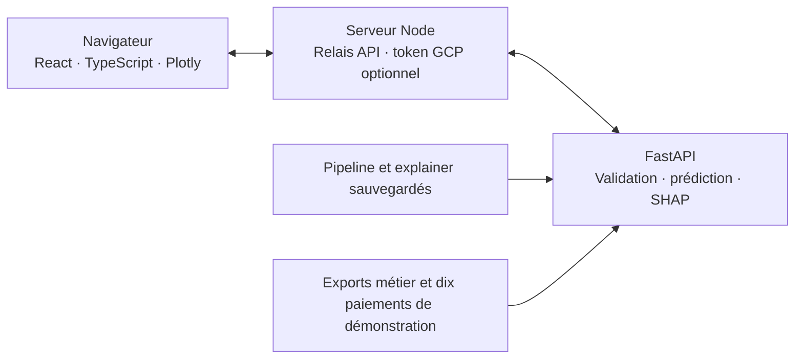

# FraudLens — Détection de fraude bancaire

**Prioriser les cartes à investiguer et expliquer les scores de fraude, dans la limite du nombre de dossiers qu’une équipe peut traiter.**

Du traitement des données à l’application React/FastAPI, ce projet évalue la détection de fraude sur **1,5 million de paiements synthétiques** dans un contexte bancaire français. L’équipe fraude et son organisation sont également fictives.

**Stack :** Python · pandas · DuckDB · scikit-learn · XGBoost · SHAP · FastAPI · React/TypeScript · Plotly · Docker.

## Objectif métier

Les analystes ne peuvent pas examiner tous les paiements suspects. L’objectif est d’améliorer les investigations à **capacité constante : 8 ou 10 dossiers par jour ouvré**. Un dossier correspond à une **carte**, regroupant ses paiements en attente.

Deux stratégies sont comparées sur les mêmes transactions :

- **Règles métier** : chaque paiement reçoit des points selon son montant, son canal, le pays du marchand et son horaire. Les cartes sont classées par somme des points.
- **XGBoost** : chaque paiement reçoit une probabilité de fraude. Les cartes sont classées par somme des probabilités.

Dans les deux cas, les égalités sont départagées par le nombre de transactions puis le montant total, dans l’ordre décroissant. **Toutes les transactions sont éligibles : aucun seuil fixe ne décide des revues.** Les dossiers non traités restent en attente au cours du mois ; une carte peut être revue à nouveau si d’autres paiements arrivent.

La règle de référence attribue **+1 point par critère** : montant ≥ 100 €, montant ≥ 250 €, paiement hors magasin, marchand hors France, horaire strictement entre minuit et 6 h en heure locale. Les deux critères de montant sont cumulatifs : un paiement de 300 € reçoit déjà 2 points pour son montant.

## Données et démarche

Le jeu complet contient **1 500 000 paiements, 3 000 clients et 5 178 cartes**, dont **7 500 paiements frauduleux, soit 0,5 %**. La cible est `fraude_confirmee`. Les 35 champs bruts décrivent le paiement, le marchand, le titulaire et la confirmation éventuelle de fraude.

L’EDA compare paiements légitimes et frauduleux, distributions, modalités et valeurs manquantes. Elle conduit à combiner le contexte d’achat et les habitudes historiques :

| Famille | Exemples de variables retenues |
| --- | --- |
| Contexte du paiement | Montant en euros, catégorie et pays marchand, pays IP, canal, mode de saisie, heure, distance domicile–marchand |
| Activité de la carte | Délai depuis le paiement précédent, paiements sur la dernière heure et depuis minuit, appareils déjà utilisés, ancienneté observée |
| Dépenses habituelles | Écart absolu à la médiane passée des paiements de la carte et de l’enseigne |
| Habitudes du client | Parts historiques par heure, catégorie marchand, pays, canal et mode de saisie |

DuckDB exprime en SQL les fenêtres temporelles et les agrégations par carte/client ; pandas gère le typage et les tableaux. Les historiques utilisent **uniquement les paiements strictement antérieurs**, en excluant ceux du même instant. Les calculs horaires utilisent `Europe/Paris` pour toutes les régions, convention conservée pour rester cohérent avec la génération des données.

Le feature engineering produit 104 colonnes ; **71 entrées sont retenues pour le modèle**. Les identifiants, noms, labels et dates de confirmation ne sont pas des entrées du classifieur. La sélection complète est centralisée dans [ModellingParameters.py](03_src/FraudDetection/DataModelling/ModellingParameters.py).

### Choix du modèle et du preprocessing

Les expérimentations du [notebook de modélisation](02_notebooks/03_model_tests.ipynb), également présentées dans le [rapport du projet](<Projet Data Science - Fraude - Détection des transactions frauduleuses (2).pdf>), comparent notamment Random Forest et XGBoost :

| Modèle | ROC AUC — test | Précision — test | Rappel — test |
| --- | ---: | ---: | ---: |
| Random Forest | 0,9503 | 47,41 % | 50,53 % |
| XGBoost | **0,9562** | **55,82 %** | **51,10 %** |

Ces essais utilisent des seuils de classification étudiés dans le notebook. XGBoost est retenu pour son compromis entre classement, précision et stabilité train/test. **L’évaluation métier finale repose sur la priorité des dossiers, sans reprendre ces seuils.**

Le pipeline servi regroupe trois étapes ajustées sur le train :

1. **One-hot encoding** des catégories et de l’heure, avec gestion des modalités inconnues.
2. **Ajout d’un score d’atypicité non supervisé, avec Isolation Forest**, calculé uniquement à partir des colonnes numériques sans valeurs manquantes à l’entraînement. Les autres variables sont conservées.
3. **Classification XGBoost**, avec les paramètres retenus centralisés dans le code, dont une pondération de la classe fraude (`scale_pos_weight=3`).

Les valeurs manquantes numériques sont conservées, sans imputation systématique. La sérialisation du pipeline garantit la réutilisation des transformations ajustées et du modèle à l’inférence.

## Résultats métier

L’entraînement porte sur **[31 décembre 2023, 1er janvier 2025[ en UTC**. L’évaluation opérationnelle compare les deux stratégies **mois par mois, de janvier à juin 2025**, sur **509 995 transactions dont 2 325 fraudes**.

La simulation ne rend disponibles que les paiements déjà arrivés à l’heure de la revue. Les sessions ont lieu à **9 h, les jours ouvrés hors jours fériés métropolitains**. La file est réinitialisée chaque mois, et la capacité est identique pour les deux méthodes.

| Capacité / jour | Méthode | Fraudes contrôlées à temps | Dossiers pertinents | Montant potentiellement récupérable |
| --- | --- | ---: | ---: | ---: |
| 8 dossiers | Règles métier | 33,41 % | 10,86 % | 38,99 % |
| 8 dossiers | **XGBoost** | **67,75 %** | **28,52 %** | **69,14 %** |
| 10 dossiers | Règles métier | 36,91 % | 9,77 % | 42,26 % |
| 10 dossiers | **XGBoost** | **69,65 %** | **24,19 %** | **70,94 %** |

À 10 dossiers par jour : **+32,74 points de fraudes contrôlées à temps** et **+28,68 points de montant potentiellement récupérable** face aux règles.

- **Fraudes contrôlées à temps** : part des transactions frauduleuses revues avant leur date de confirmation, parmi toutes les fraudes du mois.
- **Dossiers pertinents** : part des revues contenant au moins un paiement frauduleux, même examiné trop tard. Une carte revue plusieurs fois compte plusieurs revues.
- **Montant potentiellement récupérable** : part du montant fraudé examinée à temps, en supposant une récupération de 100 % de ces montants. Il s’agit d’une hypothèse de simulation, pas d’un recouvrement constaté.

**Source :** [métriques mensuelles](07_artifacts/Full_metriques_simulation_metier.csv) et [manifeste d’export](07_artifacts/Full_parametres_export_metier.json) du **18 novembre 2026**, associé au pipeline sauvegardé. Le tableau présente la **moyenne arithmétique des six taux mensuels**, comme l’interface. Chaque mois a le même poids ; ces valeurs diffèrent donc des ratios cumulés de `Full_synthese_periode_metier.csv`.

## Architecture



**FastAPI assure l’inférence ; React assure l’affichage.** Le serveur Node relaie les appels et obtient le token en mode GCP. Les modèles et exports Python restent côté API, les identifiants de service côté serveur.

```text
01_data/
  01_raw_data/             Paiements synthétiques bruts
  02_intermediate_data/    Données nettoyées et typées
  03_processed_data/       Données enrichies pour le modèle
  04_test_data/            Dix observations de démonstration
02_notebooks/              Nettoyage, EDA, comparaison des modèles, essais API/SHAP
03_src/
  FraudDetection/
    DataPreparation/      Nettoyage et feature engineering
    SQL/                  Requête DuckDB des historiques
    DataModelling/        Pipeline, paramètres et fonctions de modélisation
      Export/             Métriques métier, observations et explainer SHAP
  FastAPITools/            Schémas Pydantic et lecture des exports pour l’interface
  ReactTabs/               Onglets, appels API et waterfall Plotly
  Tools/                   Fonctions pandas, EDA et simulation métier
04_scripts/                Une commande par étape du traitement
05_pipeline/               Orchestration des six étapes
06_models/                 Pipeline XGBoost et explainer SHAP sérialisés
07_artifacts/              CSV métier et manifeste de traçabilité
08_outputs/                Sorties d’essais API
09_app_fastapi/             Application FastAPI et Dockerfile
10_app_react/               Application React, serveur Node, style, tests et Dockerfile
11_configs/                Configuration Full / Sample
pyproject.toml, uv.lock     Dépendances Python
```

`app_react.tsx` assemble les onglets de `03_src/ReactTabs`. Les dépendances frontend sont séparées des dépendances Python.

## Lancer le projet

Prérequis : **Python 3.14.0**, **uv**, **Node.js 24 LTS** et **npm**. Les commandes Python ci-dessous se lancent depuis la racine du dépôt.

```bash
uv sync --locked
```

### Préparer les données et artefacts

L’API utilise le pipeline et l’explainer de `06_models`, les résultats de `07_artifacts` et `01_data/04_test_data/observations_2025_04_21.parquet`. Si ces sorties sont déjà disponibles, passer directement au lancement des services.

Pour les reconstruire, fournir `01_data/01_raw_data/FullPaiementsCarte.parquet` et conserver `echantillon.type: Full` dans `11_configs/paths.yaml`. Les gros Parquet sont exclus du suivi Git ; leur téléchargement n’est pas automatisé dans le dépôt.

```bash
uv run python 05_pipeline/step_1_2_3_4_5_6_full_pipeline.py
```

Cette commande enchaîne **nettoyage → features → entraînement → évaluation métier → export des dix paiements → export SHAP**. Elle réentraîne et remplace les artefacts. Chaque étape peut aussi être exécutée séparément avec son script dans `04_scripts`.

### Démarrer l’API et l’interface

Premier terminal, à la racine :

```bash
uv run uvicorn 09_app_fastapi.app_fastapi:app --host 127.0.0.1 --port 8080
```

Deuxième terminal :

```bash
cd 10_app_react
npm ci
npm run dev
```

**Interface :** <http://localhost:5173> · **Documentation API :** <http://127.0.0.1:8080/docs>.

Après un export métier ou des observations, recharger la page suffit, sans JSON frontend à régénérer. Après réentraînement ou export SHAP, redémarrer FastAPI.

## API et démonstration

| Route FastAPI | Rôle |
| --- | --- |
| `GET /health` | Vérifier la disponibilité du service |
| `GET /demo-data` | Lire les dix observations exportées |
| `GET /business-metrics` | Lire les résultats métier et préparer leur moyenne d’affichage |
| `POST /batch-predict` | Recevoir 1 à 10 observations dans le champ `data`, renvoyer leurs probabilités en % |
| `POST /shap-explanation` | Expliquer 1 à 10 observations avec les contributions SHAP |

Les entrées sont définies dans [Schemas.py](03_src/FastAPITools/PydanticSchemas/Schemas.py). **L’API attend les 71 features déjà calculées**, sans identifiants ni cible ; elle ne reconstruit pas un historique à partir d’un paiement brut. Le pipeline et l’explainer sont chargés une fois par processus ; les prédictions et explications sont calculées à la demande.

L’application propose deux onglets :

- **Présentation** : démarche, comparaison mensuelle des règles et du modèle, capacités de 8 ou 10 dossiers et moyenne des mois.
- **Démonstration** : dix paiements du **21 avril 2025**, scoring au clic, tri des probabilités, choix des colonnes et explication individuelle.

Le lot contient cinq fraudes et cinq paiements légitimes aux scores contrastés. **Il ne mesure pas les performances.** Le waterfall affiche les dix principales contributions SHAP et leur reste sommé dans « Autres variables ».

SHAP réutilise le classifieur du pipeline, sans le réentraîner, avec une référence de 10 000 observations du train. Les contributions concernent les variables **après preprocessing**. Elles sont exprimées en points de pourcentage et vérifient :

```text
Probabilité de référence (%) + somme des contributions (points) = probabilité finale (%)
```

## Docker et GCP

Construction depuis **la racine du dépôt** :

```bash
docker build -f 09_app_fastapi/Dockerfile -t fraudlens-api .
docker build -f 10_app_react/Dockerfile -t fraudlens-react .
```

Une seule image permet deux modes : **sans token** (`FRAUD_AUTH_MODE=none`), ou **avec un ID token GCP obtenu côté serveur** (`FRAUD_AUTH_MODE=gcp`) pour une API Cloud Run protégée. Ces variables se passent à `docker run` avec `-e`. `FRAUD_API_URL` configure l’adresse FastAPI ; en développement local, le second mode se lance avec `npm run dev:gcp`.

Les modèles et les exports sont embarqués dans l’image API. L’image React reste indépendante des données. Voir le [README de l’interface](10_app_react/README.md) pour les variables d’environnement, l’authentification, l’exécution des conteneurs et les volumes.

## Licence

[MIT](LICENSE) · Daren Mabanza.
