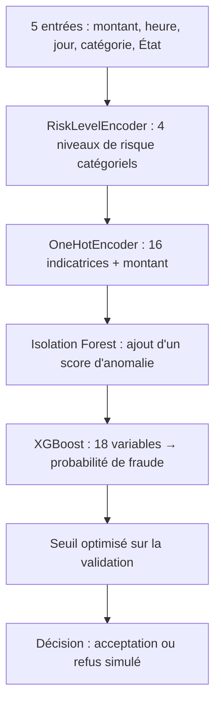

# FraudLens — Détection de fraude bancaire avec XGBoost

FraudLens est un projet de classification de transactions bancaires qui couvre la préparation des données, l’analyse exploratoire, la comparaison de modèles, l’optimisation du seuil de décision et l’exposition des prédictions dans une application.

**Le modèle final retenu est XGBoost.** Il reçoit cinq informations sur une transaction, transformées en dix-huit variables par un pipeline scikit-learn. Une API FastAPI réalise l’inférence et une interface Streamlit permet de simuler une transaction et de consulter le résultat.

L’application est une démonstration : les décisions d’acceptation et de refus affichées ne déclenchent aucune opération bancaire réelle.

**État documenté : 22 octobre 2026 · Auteur : Daren Mabanza · Version du package : 2.0.0 · Licence : MIT**

## Sommaire

- [Objectif et périmètre](#objectif-et-périmètre)
- [Données et variables](#données-et-variables)
- [Démarche de préparation et d’exploration](#démarche-de-préparation-et-dexploration)
- [Pipeline du modèle final](#pipeline-du-modèle-final)
- [Évaluation et choix de XGBoost](#évaluation-et-choix-de-xgboost)
- [Architecture du dépôt](#architecture-du-dépôt)
- [Installation et lancement local](#installation-et-lancement-local)
- [Reproduire le traitement et l’entraînement](#reproduire-le-traitement-et-lentraînement)
- [Utiliser l’API](#utiliser-lapi)
- [Interface Streamlit](#interface-streamlit)
- [Exécution avec Docker](#exécution-avec-docker)
- [Limites actuelles et prochaines étapes](#limites-actuelles-et-prochaines-étapes)
- [Licence](#licence)

## Objectif et périmètre

Le projet cherche à identifier les transactions frauduleuses dans un jeu de données très déséquilibré. La cible `is_fraud` vaut `1` pour une fraude et `0` pour une transaction légitime.

Deux types d’erreurs doivent être pris en compte :

- **Faux positif (FP)** : une transaction légitime est signalée comme frauduleuse.
- **Faux négatif (FN)** : une transaction frauduleuse est acceptée.

Le seuil de décision est choisi sur un jeu de validation pour minimiser un coût associé à ces erreurs. Il ne repose donc pas sur la valeur par défaut de `0.5`.

Le dépôt comprend actuellement le traitement des données, trois familles de modèles étudiées, le pipeline XGBoost retenu, les artefacts sauvegardés, l’API, l’interface et deux Dockerfiles. Le fichier `cloudbuild.yaml` est présent mais vide : l’automatisation du déploiement cloud reste à réaliser.

## Données et variables

### Jeux de données

Les données sont stockées au format Parquet et décrivent des transactions dans un contexte américain. Les volumes ci-dessous proviennent des sorties conservées dans les notebooks :

| Jeu | Transactions | Fraudes | Part de fraudes | Utilisation |
| --- | ---: | ---: | ---: | --- |
| `Full` | 1 852 394 | 9 651 | 0,521 % | Modélisation sur le jeu complet |
| `Sample` | 50 001 | 261 | 0,522 % | Exploration sur un échantillon plus léger |

Le jeu brut comporte **23 colonnes**. Le nettoyage en conserve **15**, puis la préparation pour la modélisation produit **8 colonnes** :

```text
id, trans_date_trans_time, jour, heure, state, category, amt, is_fraud
```

Les fichiers Parquet sont exclus du suivi Git par `.gitignore`. Ils sont présents dans l’espace de travail utilisé pour cette documentation, mais doivent être fournis séparément pour reproduire l’entraînement après un clonage. Le dépôt ne contient pas de procédure de téléchargement ni de référence explicite à la source d’origine des données.

### Les cinq variables utilisées à l’inférence

| Variable | Signification | Format attendu par l’API |
| --- | --- | --- |
| `amt` | Montant de la transaction, présenté en USD dans l’interface | Nombre strictement positif |
| `heure` | Heure de la transaction | Entier de `0` à `23` |
| `jour` | Jour de la semaine | Nom anglais, de `Monday` à `Sunday` |
| `category` | Catégorie d’achat | L’un des 14 codes acceptés |
| `state` | État américain | Code à deux lettres accepté par le schéma |

`id` sert à identifier les lignes et `trans_date_trans_time` permet le découpage chronologique. Ces deux colonnes ne sont pas transmises au classifieur. La cible `is_fraud` est toujours séparée des variables explicatives.

### Découpage chronologique

Le workflow trie les transactions par date et construit trois périodes distinctes. Les bornes de début sont incluses et les bornes de fin exclues.

| Ensemble | Période | Transactions | Fraudes | Part de fraudes | Rôle |
| --- | --- | ---: | ---: | ---: | --- |
| Entraînement | `[2019-01-01, 2020-01-01[` | 924 850 | 5 220 | 0,564 % | Apprentissage des transformations et du modèle |
| Validation | `[2020-01-01, 2020-10-01[` | 646 023 | 3 495 | 0,541 % | Choix du seuil de décision |
| Test | `[2020-10-01, 2021-01-01[` | 281 521 | 936 | 0,332 % | Évaluation sur une période ultérieure |

La proportion de fraudes diminue sur la période de test. Cette variation doit être prise en compte lors de la lecture des métriques, notamment de la précision.

## Démarche de préparation et d’exploration

### Nettoyage

La fonction `data_cleaning()` de [DataCleaning.py](03_src/FraudDetection/DataPreparation/DataCleaning.py) :

1. Charge `FullData.parquet` ou `SampleData.parquet` selon la configuration.
2. Reconstruit un identifiant séquentiel `id` et retire les six premiers caractères de `merchant`.
3. Supprime `cc_num`, `first`, `last`, `gender`, `street`, `zip`, `trans_num` et `unix_time`.
4. Convertit les dates, les variables catégorielles et les colonnes numériques vers des types adaptés, dont `uint8`, `uint32` et `float32`.
5. Vérifie la présence de `is_fraud` et des 15 colonnes attendues, puis écrit le fichier intermédiaire.

Le notebook de nettoyage rapporte une absence de valeurs manquantes dans le jeu brut inspecté. Le script réalise toutefois uniquement un contrôle minimal de structure ; il n’implémente pas encore une validation complète de qualité des données.

### Analyse exploratoire

Le notebook [02_eda.ipynb](02_notebooks/02_eda.ipynb) travaille sur `SampleDataForEda.parquet`. Il étudie les distributions, les valeurs atypiques, les modalités catégorielles, les corrélations de Pearson et de Spearman, ainsi que les relations avec la cible à l’aide de tests de Mann–Whitney et du Khi².

Parmi les observations enregistrées sur cet échantillon :

- Le montant médian est d’environ **47,35** pour les transactions légitimes, contre **346,60** pour les fraudes.
- Le test de Mann–Whitney appliqué à `city_pop` ne met pas en évidence de différence au seuil de 5 % dans cet échantillon (`p ≈ 0,653`).
- Des variables temporelles, l’âge, la distance acheteur–magasin calculée par Haversine et plusieurs statistiques de fraude par modalité ont été explorés.

Le pipeline final utilise seulement `amt`, `heure`, `jour`, `category` et `state`. Les statistiques de fraude calculées sur l’ensemble de l’échantillon exploratoire restent descriptives : l’entraînement reconstruit ses propres encodages à partir du jeu d’entraînement.

### Préparation pour la modélisation

La fonction `feature_engineering()` de [FeatureEngineering.py](03_src/FraudDetection/DataPreparation/FeatureEngineering.py) sélectionne les colonnes utiles et extrait `jour` et `heure` de `trans_date_trans_time`. Les jours suivent l’ordre `Monday` → `Sunday`. Le résultat est enregistré dans `{Full|Sample}DataForModel.parquet`.

## Pipeline du modèle final

Le pipeline est assemblé dans [Modelling.py](03_src/FraudDetection/DataModelling/Modelling.py). Les paramètres sont centralisés dans [ModellingParameters.py](03_src/FraudDetection/DataModelling/ModellingParameters.py) et les transformateurs personnalisés dans [ModellingTools.py](03_src/FraudDetection/DataModelling/ModellingTools.py).



### 1. Encodage des niveaux de risque

`RiskLevelEncoder` apprend le taux de fraude associé à chaque modalité de `heure`, `jour`, `category` et `state`, puis répartit ces taux par quantiles en quatre niveaux : `tres_faible`, `faible`, `moderee` et `elevee`.

Lors de `fit_transform`, l’encodage des lignes d’entraînement est calculé **hors pli**, avec cinq plis internes (`KFold`, mélange activé, `random_state=42`). La cible d’une ligne ne sert donc pas à calculer son propre encodage. L’encodeur apprend ensuite les statistiques sur tout le jeu d’entraînement pour transformer la validation, le test et les nouvelles transactions sans leurs étiquettes.

Une modalité inconnue ou manquante est associée au taux de fraude moyen appris avant discrétisation, lorsque celle-ci est définie. Les plis internes sont aléatoires : ils ne constituent pas une validation chronologique supplémentaire.

### 2. Encodage en indicatrices

`OneHotEncoder` transforme les quatre variables de risque en **16 indicatrices**. Les quatre niveaux sont explicitement définis pour chaque variable, aucune catégorie n’est supprimée et la sortie est dense. Le montant est conservé, ce qui produit **17 variables**.

### 3. Ajout d’un score d’anomalie

`CustomIsolationForest` apprend sur ces 17 variables et ajoute `score_anomalie = -decision_function(X)`. Un score élevé décrit une transaction plus atypique ; ce score n’est pas une probabilité de fraude.

La configuration actuelle du script utilise **300 arbres**, `max_samples="auto"`, `contamination=0.006` et `random_state=42`. Certains essais du notebook utilisent `contamination=0.07` ; il faut donc distinguer ces expériences de la configuration actuelle des scripts.

À cette étape, le classifieur reçoit **18 variables**. Isolation Forest contribue à leur construction ; **XGBoost produit la prédiction finale**.

### 4. Classification XGBoost

Les hyperparamètres retenus sont définis explicitement dans le code :

| Paramètre | Valeur |
| --- | ---: |
| `n_estimators` | `305` |
| `max_depth` | `8` |
| `learning_rate` | `0.014413697528610409` |
| `min_child_weight` | `4` |
| `subsample` | `0.902144564127061` |
| `colsample_bytree` | `0.8736932106048627` |
| `gamma` | `0.010299214204601972` |
| `reg_alpha` | `0.014899847475658236` |
| `reg_lambda` | `0.20399223998555607` |

Le notebook contient une recherche `RandomizedSearchCV` avec dix configurations, cinq plis et le score `neg_log_loss` pour XGBoost. Le script d’entraînement réutilise les valeurs retenues et ne relance pas cette recherche. Il n’ajoute pas d’étape de calibration des probabilités au pipeline final.

### 5. Optimisation du seuil

`ThresholdCostOptimizer` évalue 200 seuils régulièrement espacés entre `0` et `1` sur le jeu de validation, selon la fonction :

```text
Coût total = 20 × faux positifs + 125 × faux négatifs
```

Ces montants sont des hypothèses de coût du projet. Les scripts les affichent en euros ; ils sont distincts des montants de transaction présentés en USD dans l’interface. Le coût d’un faux négatif est fixe et ne dépend pas du montant de la transaction concernée.

L’artefact `07_artifacts/FullCostOptimizer.joblib` contient actuellement :

- un seuil de **`0.16080402010050251`**, soit environ **16,08 %** ;
- un coût minimal sauvegardé de **192 785**, avec les coefficients ci-dessus.

L’API compare la probabilité non arrondie au seuil exact de l’artefact : `probabilité > seuil`. Le pourcentage renvoyé à l’utilisateur est arrondi après le calcul de la décision. La route `/model-info` arrondit, quant à elle, le seuil à trois décimales et renvoie actuellement `0.161`.

## Évaluation et choix de XGBoost

### Comparaison des modèles étudiés

Trois familles ont été expérimentées : régression logistique, Random Forest et XGBoost. Le tableau reprend les **sorties enregistrées** dans [03_model_tests.ipynb](02_notebooks/03_model_tests.ipynb), et non une nouvelle exécution réalisée pour cette documentation.

| Modèle | ROC AUC validation ↑ | ROC AUC test ↑ | Log loss test ↓ | Coût minimal de validation enregistré ↓ |
| --- | ---: | ---: | ---: | ---: |
| Régression logistique | 0,9432 | 0,9323 | 0,013390 | 265 270 |
| Random Forest | 0,9866 | 0,9807 | 0,009952 | 189 675 |
| **XGBoost — modèle retenu** | **0,9905** | **0,9879** | **0,009443** | 192 830 |

Les résultats enregistrés soutiennent le choix de XGBoost pour sa capacité à classer les transactions et sa log loss sur les périodes de validation et de test. L’écart de ROC AUC entre entraînement et test est également plus faible que pour Random Forest dans ces sorties.

**Le choix comporte un compromis : Random Forest obtient le coût de validation le plus faible dans les essais conservés.** XGBoost n’est donc pas présenté comme le meilleur modèle sur tous les critères.

### Résultats du workflow XGBoost au seuil optimisé

Ces métriques proviennent de la section **« Test Modelling.py »** du notebook, où les décisions utilisent le seuil optimisé d’environ `0.1608`.

| Métrique | Entraînement | Validation | Test |
| --- | ---: | ---: | ---: |
| ROC AUC | 0,9921 | 0,9905 | 0,9879 |
| Précision | 51,93 % | 49,08 % | 37,28 % |
| Rappel | 68,95 % | 66,98 % | 65,60 % |
| Log loss | 0,012005 | 0,012401 | 0,009443 |

Sur la période de test, ces sorties indiquent qu’environ **65,6 % des fraudes sont détectées** et que **37,3 % des transactions signalées sont effectivement frauduleuses**. La ROC AUC élevée ne suffit donc pas à résumer l’utilité opérationnelle du modèle : le volume de fausses alertes reste un enjeu.

Deux précisions permettent de lire les résultats sans mélanger les expériences :

- Une section exploratoire antérieure du notebook utilise un seuil manuel de `0.19` pour les prédictions d’entraînement et de test. Ses valeurs de précision et de rappel ne sont pas celles du tableau ci-dessus.
- Le coût de validation sauvegardé dans l’artefact actuel est **192 785**, alors que le notebook affiche **192 830**. Le seuil est identique, mais les sorties historiques ne certifient pas à elles seules toutes les métriques du fichier actuellement servi. Une réévaluation de cet artefact est nécessaire pour les confirmer.

## Architecture du dépôt

```text
V2_projet_fraud_detection/
├── 01_data/
│   ├── 01_raw_data/              # FullData.parquet / SampleData.parquet
│   ├── 02_intermediate_data/     # {Full|Sample}DataForEda.parquet
│   └── 03_processed_data/        # {Full|Sample}DataForModel.parquet
├── 02_notebooks/
│   ├── 01_cleaning.ipynb         # Inspection et nettoyage
│   ├── 02_eda.ipynb              # Exploration et essais de variables
│   ├── 03_model_tests.ipynb      # Comparaison, réglages et évaluation
│   └── 04_api_tests.ipynb        # Essais manuels d’inférence et d’API
├── 03_src/
│   ├── FraudDetection/
│   │   ├── DataPreparation/     # Nettoyage et feature engineering
│   │   └── DataModelling/       # Pipeline, paramètres et transformateurs
│   ├── FastAPITools/
│   │   └── PydanticSchemas/     # Contrats de validation de l’API
│   ├── StreamlitTabs/           # Présentation et formulaire
│   └── Tools/                   # Fonctions d’EDA et conversions de types
├── 04_scripts/                  # Exécution séparée des trois étapes
├── 05_pipeline/
│   └── step_1_2_3_full_pipeline.py
├── 06_models/
│   └── FullXGBoostModel_V1.joblib
├── 07_artifacts/
│   └── FullCostOptimizer.joblib
├── 08_outputs/                  # Répertoire réservé aux sorties
├── 09_app_fastapi/
│   ├── app_fastapi.py
│   └── Dockerfile
├── 10_app_streamlit/
│   ├── app_streamlit.py
│   ├── style.css
│   ├── README.md
│   └── Dockerfile
├── 11_configs/
│   └── paths.yaml               # Sélection Full / Sample
├── .streamlit/config.toml       # Thème et configuration Streamlit
├── .dockerignore
├── .gitignore
├── cloudbuild.yaml              # Présent, encore vide
├── pyproject.toml
├── uv.lock
├── LICENSE
└── README.md
```

Le pipeline sauvegardé inclut les transformations et le classifieur. L’optimiseur de coût est enregistré dans un second fichier. Ces deux artefacts doivent être conservés ensemble pour servir le modèle avec son seuil associé.

## Installation et lancement local

### Prérequis

- **Python 3.14** : le verrou `uv.lock` indique `requires-python = ">=3.14"` et les images Docker utilisent Python 3.14.
- **uv** pour installer les dépendances à partir de `pyproject.toml` et `uv.lock`.
- Les deux artefacts `FullXGBoostModel_V1.joblib` et `FullCostOptimizer.joblib` pour lancer l’API. Les données d’entraînement ne sont pas nécessaires pour utiliser les applications avec ces artefacts.
- Les données Parquet brutes pour relancer le traitement et l’entraînement.

**Toutes les commandes suivantes sont à exécuter depuis la racine `V2_projet_fraud_detection/`.** Les scripts de traitement et l’API utilisent des chemins relatifs à ce répertoire.

### Installer les dépendances

Pour disposer de l’exploration, de l’entraînement et des deux applications :

```bash
uv sync --locked --all-extras --python 3.14
```

Les groupes optionnels sont organisés par usage :

| Extra | Contenu principal |
| --- | --- |
| `ml` | pandas, NumPy, scikit-learn, XGBoost, PyYAML |
| `exploration` | PyArrow, Fastparquet, SciPy, Matplotlib, Seaborn, Plotly, DuckDB, Kaleido |
| `fastapi` | FastAPI, Pydantic et dépendances nécessaires au chargement du modèle |
| `streamlit` | Interface Streamlit |

L’installation avec tous les extras est recommandée pour travailler sur l’ensemble du projet : l’entraînement utilise aussi la lecture Parquet et importe Matplotlib via les outils de modélisation. `ipykernel` fait partie des dépendances de base.

Pour utiliser uniquement l’API et l’interface avec les artefacts existants :

```bash
uv sync --locked --extra fastapi --extra streamlit --python 3.14
```

### Démarrer les applications

Dans un premier terminal, lancer l’API :

```bash
uv run --no-sync uvicorn app_fastapi:app --app-dir 09_app_fastapi --host 127.0.0.1 --port 8000
```

Dans un second terminal, lancer l’interface :

```bash
uv run --no-sync streamlit run 10_app_streamlit/app_streamlit.py
```

| Service | Adresse locale |
| --- | --- |
| Interface FraudLens | <http://localhost:8501> |
| État de l’API | <http://127.0.0.1:8000/health> |
| Documentation interactive de l’API | <http://127.0.0.1:8000/docs> |
| Schéma OpenAPI | <http://127.0.0.1:8000/openapi.json> |

L’option `--no-sync` réutilise l’environnement installé à l’étape précédente. L’API charge les deux artefacts au démarrage ; elle doit être redémarrée après leur remplacement.

Pour connecter Streamlit à une autre adresse, définir `FRAUD_API_URL` avec l’URL de base du service, sans `/predict` ni `/model-info`. Exemple sous Bash :

```bash
FRAUD_API_URL=http://127.0.0.1:8000 uv run --no-sync streamlit run 10_app_streamlit/app_streamlit.py
```

## Reproduire le traitement et l’entraînement

### Choisir le jeu de données

Le fichier [11_configs/paths.yaml](11_configs/paths.yaml) contient actuellement :

```yaml
echantillon:
  type: Full
```

Remplacer `Full` par `Sample` permet de travailler sur l’échantillon. Les noms sont sensibles à la casse. Placer le fichier correspondant dans `01_data/01_raw_data/` :

```text
01_data/01_raw_data/FullData.parquet
01_data/01_raw_data/SampleData.parquet
```

Le code attend le schéma brut étudié dans `01_cleaning.ipynb`, notamment les colonnes supprimées lors du nettoyage. Un fichier contenant uniquement les cinq entrées de l’API ne convient pas à cette étape.

### Exécuter le workflow

Lancer les trois étapes séparément :

```bash
uv run --no-sync python 04_scripts/step_1_data_cleaning.py
uv run --no-sync python 04_scripts/step_2_feature_engineering.py
uv run --no-sync python 04_scripts/step_3_modelling.py
```

Ou exécuter l’enchaînement complet :

```bash
uv run --no-sync python 05_pipeline/step_1_2_3_full_pipeline.py
```

| Étape | Entrée | Sortie |
| --- | --- | --- |
| Nettoyage | `01_data/01_raw_data/{Full\|Sample}Data.parquet` | `01_data/02_intermediate_data/{Full\|Sample}DataForEda.parquet` |
| Préparation | Fichier intermédiaire | `01_data/03_processed_data/{Full\|Sample}DataForModel.parquet` |
| Modélisation | Fichier préparé | `06_models/{Full\|Sample}XGBoostModel_V1.joblib` et `07_artifacts/{Full\|Sample}CostOptimizer.joblib` |

La modélisation affiche les durées de préparation et d’entraînement, le seuil, le coût de validation, puis la ROC AUC, la précision, le rappel et la log loss sur les trois ensembles.

Les répertoires de sortie doivent exister. Une nouvelle exécution remplace les fichiers portant les mêmes noms. Le mode `Sample` produit ses propres artefacts, mais **l’API charge actuellement les fichiers `Full` avec des chemins fixes** : modifier `paths.yaml` ne change pas le modèle servi.

### Ouvrir les notebooks

Utiliser un environnement compatible Jupyter, par exemple l’extension Jupyter de VS Code, avec l’interpréteur `.venv/bin/python` comme noyau. Certains notebooks contiennent un `%cd` absolu vers la machine de développement : adapter ce chemin avant exécution.

Les notebooks conservent des essais et des états intermédiaires. Pour reproduire le workflow courant, utiliser les scripts de `04_scripts/` ou `05_pipeline/`. `04_api_tests.ipynb` contient des appels HTTP manuels et nécessite que l’API soit démarrée.

## Utiliser l’API

Le service est défini dans [app_fastapi.py](09_app_fastapi/app_fastapi.py), avec les schémas de validation de [Schemas.py](03_src/FastAPITools/PydanticSchemas/Schemas.py).

| Méthode | Route | Fonction |
| --- | --- | --- |
| `GET` | `/health` | Retourne `{"status": "ok"}` lorsque le service répond |
| `POST` | `/predict` | Analyse une transaction et retourne la décision et la probabilité |
| `GET` | `/model-info` | Retourne le nom du modèle, sa version déclarée, son seuil arrondi et ses variables |

### Prédire une transaction

Le corps de la requête est **un objet JSON unique** contenant les cinq champs obligatoires :

```bash
curl --request POST http://127.0.0.1:8000/predict \
  --header 'Content-Type: application/json' \
  --data '{"amt": 950.0, "heure": 2, "jour": "Saturday", "category": "shopping_net", "state": "CA"}'
```

Exemple de résultat conservé dans le notebook d’essais pour cette transaction ; la probabilité peut changer avec l’artefact utilisé :

```json
{
  "message": "La transaction a été refusé",
  "prédiction": 1,
  "probabilité": 81.63
}
```

- `prédiction = 1` signifie que la transaction est signalée comme frauduleuse et refusée dans la simulation.
- `prédiction = 0` signifie qu’elle est acceptée dans la simulation.
- `probabilité` est déjà exprimée en **pourcentage de 0 à 100**, arrondie à deux décimales.

Les clés accentuées et le texte de l’exemple correspondent au contrat actuellement implémenté.

### Validation des entrées

Pydantic refuse les champs supplémentaires (`extra="forbid"`). Le montant doit être un nombre JSON strictement positif ; l’heure doit être un entier JSON de `0` à `23`. Les chaînes numériques ne remplacent pas ces types.

Les jours doivent être fournis en anglais :

```text
Monday, Tuesday, Wednesday, Thursday, Friday, Saturday, Sunday
```

Les catégories autorisées sont :

```text
entertainment, food_dining, gas_transport, grocery_net, grocery_pos,
health_fitness, home, kids_pets, misc_net, misc_pos, personal_care,
shopping_net, shopping_pos, travel
```

`state` accepte les codes des 50 États américains et `DC`, définis explicitement dans le schéma. Les entrées non conformes produisent une réponse HTTP `422`. La route de prédiction ne prend pas en charge les lots de transactions.

### Consulter les informations du modèle

```bash
curl http://127.0.0.1:8000/model-info
```

Réponse attendue avec l’optimiseur actuellement sauvegardé :

```json
{
  "model": "FullXGBoostModel",
  "version": "1.1",
  "seuil": 0.161,
  "variables": ["amt", "heure", "jour", "category", "state"]
}
```

Ici, `seuil` est une valeur entre `0` et `1`, contrairement à `probabilité` dans `/predict`. Les chemins des artefacts ne figurent pas dans la réponse publique, qui est filtrée par `ModelInfoOutput`.

La version du package (`2.0.0`), la version déclarée de l’API (`1.0.0`), celle renvoyée par `/model-info` (`1.1`) et le suffixe du fichier modèle (`V1`) sont actuellement distincts.

## Interface Streamlit

L’interface **FraudLens** comporte deux pages :

- **Présentation du projet** : explication des transformations, informations récupérées depuis `/model-info` et accès au formulaire.
- **Utilisation de l’outil** : saisie d’une transaction, envoi à `/predict`, affichage de la décision, du pourcentage de fraude et du récapitulatif.

Les menus sont traduits en français, tandis que les valeurs transmises à l’API conservent les codes utilisés à l’entraînement. Aucun modèle n’est chargé dans Streamlit : l’inférence et la décision sont réalisées par FastAPI.

Les informations du modèle sont mises en cache pendant 60 secondes par URL, avec un délai HTTP de 5 secondes et un bouton d’actualisation. La prédiction est demandée uniquement à la soumission du formulaire, avec un délai de 12 secondes. L’interface affiche les erreurs du service et efface l’ancien résultat lorsqu’une nouvelle analyse échoue.

Le thème est défini dans `.streamlit/config.toml` et les styles complémentaires dans `10_app_streamlit/style.css`. La [documentation de l’interface](10_app_streamlit/README.md) détaille le lancement et le dépannage de cette partie.

## Exécution avec Docker

Deux Dockerfiles sont présents, avec une base `ghcr.io/astral-sh/uv:python3.14-bookworm-slim`. Le contexte de construction est **la racine du projet**, afin d’inclure le package, sa configuration et les artefacts nécessaires à l’API.

Construire les images :

```bash
docker build -f 09_app_fastapi/Dockerfile -t fraudlens-api .
docker build -f 10_app_streamlit/Dockerfile -t fraudlens-streamlit .
```

Créer un réseau commun :

```bash
docker network create fraudlens-network
```

Lancer l’API dans un premier terminal :

```bash
docker run --rm --name fraudlens-api \
  --network fraudlens-network \
  -p 127.0.0.1:8000:8000 \
  fraudlens-api
```

Lancer Streamlit dans un second terminal :

```bash
docker run --rm --name fraudlens-streamlit \
  --network fraudlens-network \
  -p 127.0.0.1:8501:8501 \
  -e FRAUD_API_URL=http://fraudlens-api:8000 \
  fraudlens-streamlit \
  uv run --no-sync streamlit run 10_app_streamlit/app_streamlit.py \
  --server.address=0.0.0.0 --server.port=8501
```

L’interface reste accessible sur <http://localhost:8501>. Depuis son conteneur, elle contacte l’API avec le nom `fraudlens-api` sur le réseau Docker. L’adresse d’écoute Streamlit est explicitée dans la commande de lancement.

`.dockerignore` exclut notamment les données, les notebooks, les scripts d’entraînement, les environnements locaux et les fichiers de secrets du contexte de construction. Les artefacts du modèle sont copiés dans l’image API. Les images doivent être reconstruites après modification des fichiers qu’elles embarquent.

Les Dockerfiles décrivent la construction des services ; leur présence ne constitue pas une validation de leur exécution. Aucun déploiement cloud ni pipeline Cloud Build opérationnel n’est documenté dans le dépôt à ce stade.

## Limites actuelles et prochaines étapes

| Sujet | État actuel et suite envisagée |
| --- | --- |
| Traçabilité des données | Documenter la source, les conditions d’utilisation et la méthode de constitution de `Full` et `Sample`, puis ajouter une procédure d’acquisition reproductible. |
| Résultats du modèle servi | Réévaluer l’artefact actuel sur les jeux temporels et enregistrer métriques, paramètres, versions et seuil dans un rapport associé. Les tableaux de ce README sont issus des notebooks. |
| Alertes et fraudes manquées | Les sorties historiques donnent 37,28 % de précision et 65,60 % de rappel sur le test au seuil optimisé. Compléter l’analyse par la courbe précision–rappel, l’average precision et les coûts opérationnels réellement retenus. |
| Protocole temporel | Le découpage principal est chronologique, mais les plis internes d’encodage et la recherche d’hyperparamètres ne suivent pas un protocole temporel. Évaluer une validation glissante et la stabilité des résultats par période. |
| Probabilités | Le notebook explore la calibration, mais le pipeline final ne comporte pas de calibrateur. Évaluer la calibration du modèle sauvegardé avant d’interpréter ses scores comme des risques opérationnels. |
| Qualité des données | Les scripts contrôlent surtout les dimensions et la cible. Les contrôles plus complets, notamment via Great Expectations mentionné dans les commentaires, restent à implémenter. |
| Reproductibilité des notebooks | Des cellules conservent des essais, des chemins absolus et des sorties historiques. Harmoniser les notebooks avec les scripts avant de garantir une exécution intégrale dans l’ordre. |
| Règle au seuil | L’optimiseur compte une fraude pour `p >= seuil`, tandis que les métriques du workflow et l’API utilisent `p > seuil`. Harmoniser ce cas limite. |
| Versions et chargement | Harmoniser les versions déclarées et rendre configurables les chemins `Full` actuellement fixés dans l’API. |
| Tests et exploitation | Les essais d’API sont manuels. Ajouter des tests automatisés du pipeline et du contrat HTTP, puis compléter Cloud Build et le suivi des performances et de la dérive des données. |

Cette documentation décrit les sources, la configuration, les sorties de notebooks et les artefacts disponibles au 22 octobre 2026. Les métriques n’ont pas été recalculées lors de sa rédaction et les services n’ont pas été relancés dans l’environnement de revue, dont les dépendances Python ne sont pas installées.

## Licence

Le code est distribué sous [licence MIT](LICENSE).
